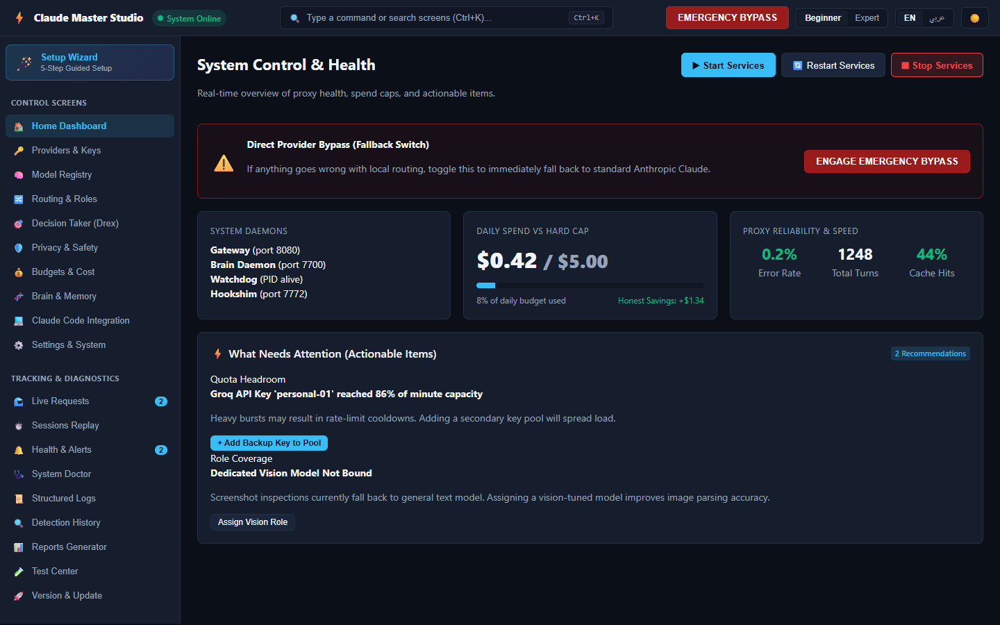
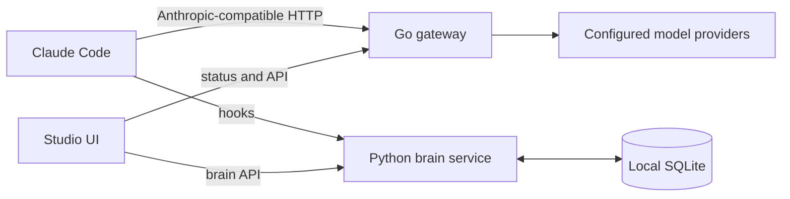
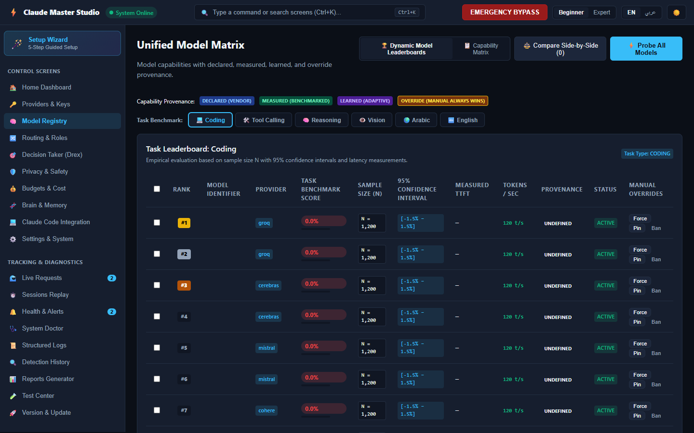
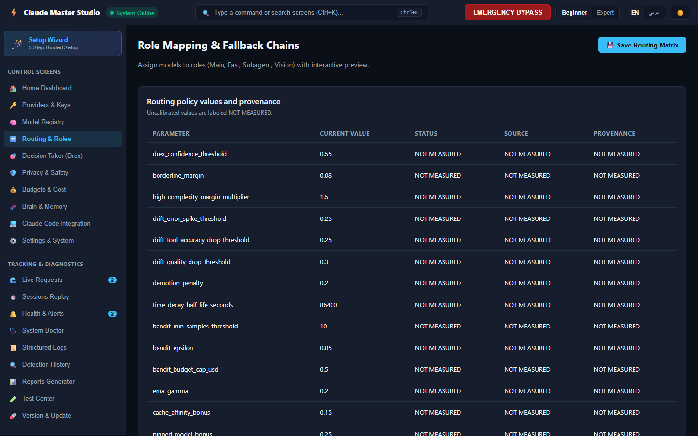
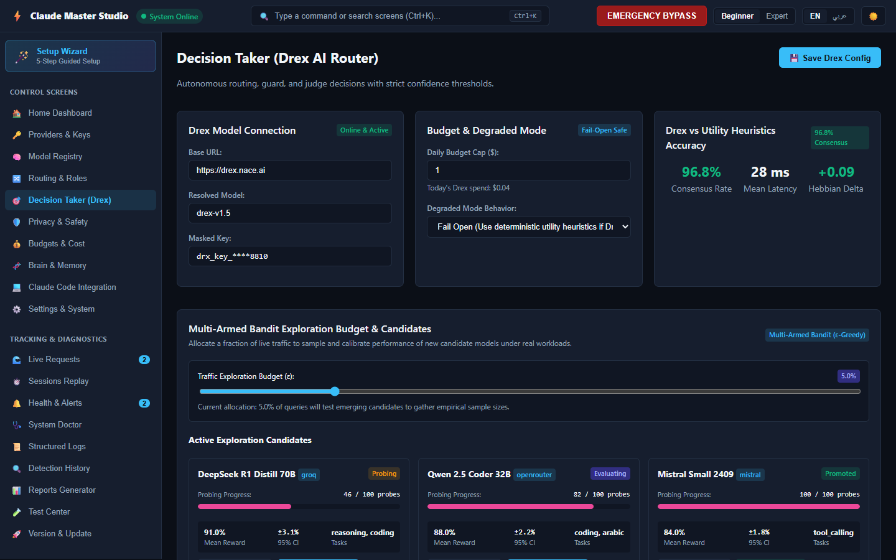

# Claude Master

[](https://github.com/01RG0/claude-master/actions/workflows/ci.yml)

Claude Master is a local gateway and companion toolkit for using Claude Code with configured model providers. It includes a Go gateway, a Python brain service, a TypeScript Studio, and Windows-oriented command scripts. It is not a hosted model service, and provider availability, pricing, and free-tier access depend on your own accounts and configuration.

> **Evidence note:** benchmark quality and runtime metrics are shown only when measured. Missing measurements are labeled **NOT MEASURED**; the project does not promise that a model is free, reliable, or suitable for a task.



## Contents

- [What’s in the project](#whats-in-the-project)
- [Architecture](#architecture)
- [Quick start](#quick-start)
- [Studio screenshots](#studio-screenshots)
- [Documentation](#documentation)
- [Development and tests](#development-and-tests)
- [Security and provider credentials](#security-and-provider-credentials)
- [License](#license)

## What’s in the project

- `gateway/` — Go HTTP gateway and provider integrations.
- `brain/` — Python service for hooks, storage, learning, and decision support.
- `hookshim/`, `watchdog/` — Go helper programs.
- `studio/` — TypeScript browser UI for system status, providers, models, and routing.
- `tools/cm/`, `scripts/` — command-line and setup/operations scripts.
- `data/` — provider, model, and related configuration data.

Features depend on the configured services and providers. A dashboard or model catalog entry is not evidence that a provider is configured or that a model has benchmarked successfully.

## Architecture



See [Architecture](docs/architecture.md) for more detail. Some platform-specific details in older design documents may be stale; use the scripts and current configuration as the operational source of truth.

## Quick start

The repository includes Windows command wrappers (`cm.ps1` and `cm.cmd`) and a cross-platform Python bootstrap. First install the language runtimes listed in [Compatibility](docs/compatibility-matrix.md), then:

```powershell
python scripts/bootstrap.py
```

On Windows, the `cm` wrapper is available at `tools\cm\cm.ps1` (or `tools\cm\cm.cmd`):

```powershell
tools\cm\cm.ps1 doctor
tools\cm\cm.ps1 setup
tools\cm\cm.ps1 start
```

For manual startup, environment configuration, Claude Code setup, and health checks, follow the [Runbook](docs/runbook.md). Do not assume that upstream providers are free or that the gateway can route without valid provider configuration and credentials.

## Studio screenshots

| Model catalog | Routing simulator | Decision traces |
|---|---|---|
|  |  |  |

These are UI screenshots, not benchmark results. The Studio also has screens for setup, provider configuration, privacy, budgets, memory, logs, and diagnostics in [`docs/screenshots/`](docs/screenshots/).

## Documentation

- [Runbook and startup](docs/runbook.md)
- [Architecture](docs/architecture.md)
- [Troubleshooting](docs/troubleshooting.md)
- [Provider integration guide](docs/adding-a-provider.md)
- [Compatibility matrix](docs/compatibility-matrix.md)
- [Routing report](docs/routing-report.md) and [benchmark notes](docs/benchmarks.md)
- [Test report](docs/test-report.md)
- [Current status and blockers](docs/STATUS.md) and [known blockers](docs/BLOCKERS.md)
- [Apache-2.0 license](LICENSE) and [third-party notices](NOTICE)
- [License audit notes](docs/licenses.md) (provenance discussion, not a license grant)

## Development and tests

Run checks from the repository root:

```powershell
python scripts/secret_scan.py
python -m pytest -q
```

Go components:

```powershell
cd gateway; go test ./...; cd ..
cd hookshim; go test ./...; cd ..
cd watchdog; go test ./...; cd ..
```

Studio:

```powershell
cd studio
npm install
npm run typecheck
npm test
```

CI runs Python, Go, Studio, and Windows checks on pushes and pull requests. See the [workflow](.github/workflows/ci.yml) for the actual gates; this README intentionally does not pin test counts that change over time.

## Security and provider credentials

Keep provider keys in environment variables or local configuration that is excluded from version control. Never commit real credentials. Review the [troubleshooting guide](docs/troubleshooting.md) and [runbook](docs/runbook.md) before exposing a local gateway beyond loopback.

## License

The project is licensed under [Apache License 2.0](LICENSE). Third-party components and assets may retain their own licenses; consult [NOTICE](NOTICE) and their upstream license terms. The audit notes in [`docs/licenses.md`](docs/licenses.md) are provenance discussion, not a substitute for those terms.
